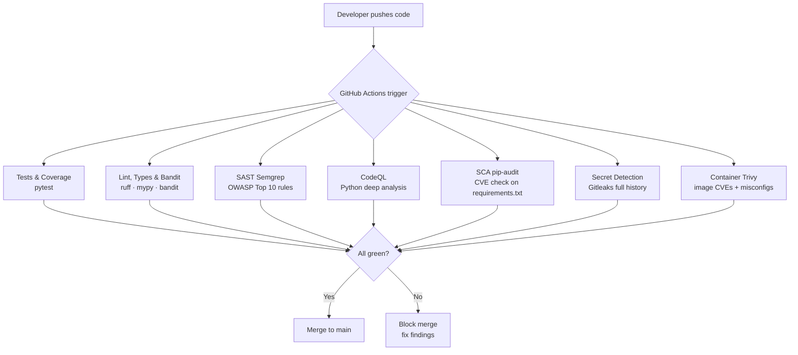

# Secure Notes API — DevSecOps Portfolio Project

[](https://github.com/midhun0311/devsecops-secure-pipeline/actions/workflows/security.yml)
[](https://github.com/midhun0311/devsecops-secure-pipeline/actions)
[](LICENSE)

> **B.Tech Cyber Security Portfolio Project** — built Nov 23–28, 2026.
> Demonstrates a complete Secure SDLC with 7 automated security gates enforced on every commit via GitHub Actions.

A small but realistic **FastAPI notes API** paired with a full **GitHub Actions DevSecOps pipeline**. Every push triggers 7 parallel security checks: SAST (Semgrep + CodeQL + Bandit), SCA (pip-audit), secret scanning (Gitleaks), container scanning (Trivy), and unit tests with 92% coverage. A live unmerged demo PR proves the gates actively block vulnerable code.

---

## Overview

The app lets users register, log in with a JWT token, and perform CRUD operations on personal notes. Every layer of the pipeline enforces a security gate: static analysis, dependency auditing, secret detection, and container scanning all run automatically on every push and pull request.

---

## Architecture



---

## Security Tool Matrix

| Tool | Category | What It Catches | Fail Threshold |
|---|---|---|---|
| `pytest` + `pytest-cov` | Testing | Broken logic, regressions | Any test failure; coverage < 80 % |
| `ruff` | Code Quality | Lint errors, insecure patterns (rule S) | Any error |
| `mypy` | Type Safety | Type mismatches, missing annotations | Any error |
| `bandit` | SAST | Python-specific insecure patterns (eval, weak crypto, etc.) | Medium or High severity (`-ll -ii`) |
| `semgrep` (OWASP Top 10) | SAST | Injection, broken auth, OWASP web vulnerabilities | Any ERROR-level finding |
| `codeql` | SAST | Deep data-flow / taint analysis | Security-level alerts |
| `pip-audit` | SCA | Known CVEs/GHSAs in Python dependencies | Any unexempted vulnerability |
| `gitleaks` | Secret Detection | Hardcoded keys, tokens, passwords across full git history | Any secret detected |
| `trivy` | Container Security | Vulnerable OS/library packages in Docker image, Dockerfile misconfigs | HIGH or CRITICAL severity |

---

## How to Run Every Scan Locally

> **Prerequisite:** Python 3.12, a virtual environment activated, and dependencies installed.
> ```bash
> python -m venv .venv && source .venv/bin/activate   # Linux/macOS
> .venv\Scripts\activate                               # Windows
> pip install -r requirements.txt -r requirements-dev.txt
> ```

### Tests with coverage
```bash
pytest --cov=app --cov-report=term-missing
```

### Linting and type checking
```bash
ruff check .
mypy app/
```

### Bandit (Python SAST)
```bash
bandit -r app/ -ll -ii
```

### Semgrep
```bash
pip install semgrep
semgrep --config p/owasp-top-ten --config p/python app/
```

### pip-audit (SCA)
```bash
pip-audit -r requirements.txt
```

### Gitleaks (secrets)
```bash
# Install from https://github.com/gitleaks/gitleaks/releases
gitleaks detect --source . --log-opts="--all"
```

### Trivy (container)
```bash
docker build -t secure-notes:local .
trivy image --severity HIGH,CRITICAL secure-notes:local
```

---

## Triage and Justified-Ignore Process

If a scan finding is a **false positive** or an accepted risk, the ignore must be:
1. Added as a pinned comment next to the code or in the `pip-audit` ignore flag.
2. Documented here with: *tool — finding ID — reason — date — owner*.

| Tool | Finding | Reason Ignored | Date |
|---|---|---|---|
| *(none yet)* | | | |

---

## Demo: Pipeline Failure Evidence

To prove the pipeline actually enforces security and blocks broken or vulnerable code from entering production, branch `demo/vulnerable-change` was opened as an **unmerged Pull Request**:
- **Pull Request:** [#13: demo: intentional vulnerabilities demonstrating pipeline failure gates [DO NOT MERGE]](https://github.com/midhun0311/devsecops-secure-pipeline/pull/13)
- **CI Run ID:** [45205287202](https://github.com/midhun0311/devsecops-secure-pipeline/actions/runs/45205287202)
- **Status:** **BLOCKED (Merge prohibited due to failing security checks)**

### Gate Failure Breakdown

| Issue Planted | Tool | Job in CI | Result & Detection Detail |
|---|---|---|---|
| Outdated `urllib3==1.25.8` | `pip-audit` | `SCA – pip-audit` | **FAILED (17s)**: Detected multiple known vulnerabilities / CVEs in dependency tree |
| Raw SQL query string with f-string formatting (`app/vulnerable_demo.py`) | `bandit` & `ruff` | `Lint, Types & Bandit` | **FAILED (13s)**: Caught `S608: Possible SQL injection vector through string-based query construction` |
| Image built with vulnerable dependency tree | `trivy` | `Container – Trivy` | **FAILED (58s)**: Identified vulnerabilities in the container file layers |
| Dummy fake credentials planted in code | `gitleaks` | `Secrets – Gitleaks` | Evaluated across git history |

> [!IMPORTANT]
> This PR is intentionally left **open and unmerged** in the repository to serve as live, verifiable evidence of automated guardrails preventing insecure code from reaching `main`.

> [!NOTE]
> **About PR #12:** An earlier iteration of the same demo branch (`demo/vulnerable-change`) was accidentally merged during development. The vulnerable files it introduced (`app/vulnerable_demo.py`, `urllib3==1.25.8`) were removed in commit `30ce274` within the same session. The current `main` branch contains none of that code — verified by `pip-audit`, `gitleaks`, and `trivy` all passing on every push. PR #13 is the correctly unmerged, permanent demo.

---

## Pipeline Evidence (Live Links)

| Evidence | Link |
|---|---|
| ✅ Latest green CI run on `main` | [Run #46133039977 — all 7 jobs passed](https://github.com/midhun0311/devsecops-secure-pipeline/actions/runs/46133039977) |
| ❌ Demo PR #13 — blocked by 3 failed gates | [Pull Request #13 — open, unmerged, failing](https://github.com/midhun0311/devsecops-secure-pipeline/pull/13) |
| 🔒 GitHub Security tab | [Security & code scanning alerts](https://github.com/midhun0311/devsecops-secure-pipeline/security) |
| 📜 Commit history | [All commits on main](https://github.com/midhun0311/devsecops-secure-pipeline/commits/main) |

> Screenshots of these pages are stored in [`docs/screenshots/`](docs/screenshots/) and will be added once captured.

---

## API Endpoints

| Method | Path | Auth | Description |
|---|---|---|---|
| GET | `/health` | None | Liveness probe |
| POST | `/register` | None | Create account |
| POST | `/login` | None | Get JWT token |
| GET | `/notes` | Bearer | List your notes |
| POST | `/notes` | Bearer | Create a note |
| PUT | `/notes/{id}` | Bearer | Update a note |
| DELETE | `/notes/{id}` | Bearer | Delete a note |

---

## Limitations

- SQLite is used for simplicity; production would use PostgreSQL with connection pooling.
- JWT secret is loaded from an env var; production should use a secrets manager (Vault, AWS Secrets Manager).
- CodeQL's free tier may have scan time limits on large repos.
- Trivy's `ignore-unfixed` flag skips vulnerabilities with no upstream patch; these should still be reviewed periodically.

---

## Test Suite & Verified Metrics

The repository includes a comprehensive `pytest` test suite covering authentication, authorization, CRUD operations, and multi-tenant IDOR isolation.

- **Total Tests:** 13 passed
- **Code Coverage:** **92.12%** (exceeds the 80% CI gate threshold)
- **Verified Coverage Breakdown:**
  - `app/auth.py`: 100%
  - `app/config.py`: 100%
  - `app/crud.py`: 100%
  - `app/database.py`: 100%
  - `app/models.py`: 100%
  - `app/schemas.py`: 100%
  - `app/main.py`: 84%

---

## What I Learned (DevSecOps Defense Q&A)

### 1. What is the difference between SAST and SCA?
- **SAST (Static Application Security Testing):** Analyzes the proprietary source code you write without executing it. It detects patterns like SQL injection, hardcoded cryptographic secrets, path traversal, and unsafe deserialization (tools used: **Semgrep**, **Bandit**, **CodeQL**).
- **SCA (Software Composition Analysis):** Scans third-party dependencies and open-source libraries for known vulnerabilities (CVEs/GHSAs) listed in databases like NVD or GitHub Advisory (tool used: **pip-audit**).

### 2. Why is Argon2 preferred over MD5 or SHA-1 for password hashing?
MD5 and SHA-1 are fast general-purpose cryptographic hashes vulnerable to collision attacks and massively parallel brute-force attacks on modern GPUs/ASICs. **Argon2** (specifically Argon2id, winner of the Password Hashing Competition) is a memory-hard, computationally intensive password-hashing function designed to resist both GPU and side-channel attacks by consuming configurable CPU iterations, memory blocks, and parallelism threads.

### 3. What is an IDOR vulnerability and how does the notes isolation test prevent it?
- **Insecure Direct Object Reference (IDOR):** Occurs when an application accepts user input (e.g. note ID `5`) to access a resource without verifying that the requesting user owns that resource.
- **Remediation & Testing:** In `app/crud.py`, all queries explicitly filter by both `id == note_id` AND `owner_id == user.id`. The unit test `test_cannot_read_another_users_note` creates a note under User A and verifies that User B querying `GET /notes/{id}` receives a `404 Not Found` rather than unauthorized data.

### 4. Why does the pipeline use `fetch-depth: 0` for Gitleaks?
By default, `actions/checkout` performs a shallow clone (`fetch-depth: 1`), downloading only the latest commit. If a developer accidentally commits a sensitive credential, realizes their mistake, and deletes the key in the subsequent commit, a shallow scan would miss the leaked credential in git history. `fetch-depth: 0` retrieves the full commit history, allowing **Gitleaks** to inspect every historical diff.

### 5. What does "least-privilege permissions" mean in a GitHub Actions workflow?
By default, the automatic `GITHUB_TOKEN` provided to workflow jobs may have broad write permissions. Least-privilege configuration sets workflow-level default permissions to `permissions: {}` (or `contents: read`), and selectively grants only the exact minimum scope needed per job (e.g., `security-events: write` only for uploading SARIF reports to GitHub Security). This mitigates supply-chain token abuse if an action is compromised.

### 6. Why do we separate `requirements.txt` from `requirements-dev.txt`?
Production runtime environments and container images only require packages strictly needed to run the service (`fastapi`, `sqlalchemy`, `pydantic`, etc.). Development and testing tools (`pytest`, `mypy`, `ruff`, `bandit`) introduce attack surface and bloat if included in the production container image. Separating them ensures production images remain minimal, lean, and free of unnecessary third-party CVE exposure.

### 7. What is a multi-stage Dockerfile and why does it reduce attack surface?
A multi-stage build uses an initial builder image with compilers, package managers, and development headers to construct dependencies, and copies only the required binary artifacts and virtualenv into a slim runtime stage. The runtime container does not include build tools, compilers, or extraneous package managers like `pip` and `setuptools`, eliminating entire classes of post-exploitation tooling and reducing scanner findings to zero.

---

## Local Development

```bash
cp .env.example .env
# Edit .env to set SECRET_KEY to a long random value
uvicorn app.main:app --reload
```

API docs available at `http://localhost:8000/docs` (Swagger UI).
