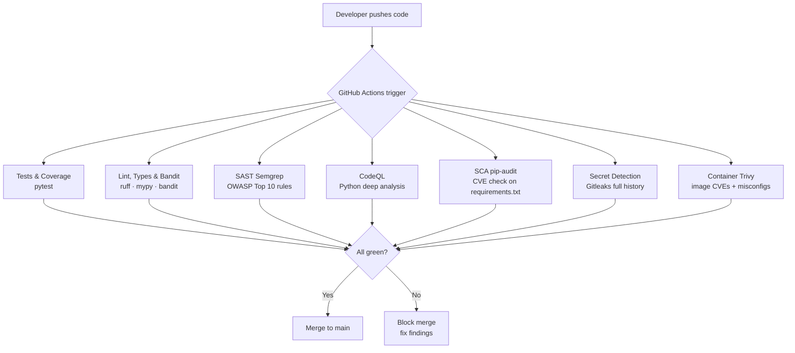

# Secure Notes API — DevSecOps Portfolio Project

[](https://github.com/midhun0311/devsecops-secure-pipeline/actions/workflows/security.yml)

A small but realistic **FastAPI notes API** paired with a full **GitHub Actions DevSecOps pipeline**. Built as a portfolio project for a B.Tech Cyber Security student to demonstrate secure SDLC practices end-to-end.

---

## Overview

The app lets users register, log in with a JWT token, and perform CRUD operations on personal notes. Every layer of the pipeline enforces a security gate: static analysis, dependency auditing, secret detection, and container scanning all run automatically on every push and pull request.

---

## Architecture



---

## Security Tool Matrix

| Tool | Category | What It Catches | Fail Threshold |
|---|---|---|---|
| `pytest` + `pytest-cov` | Testing | Broken logic, regressions | Any test failure; coverage < 80 % |
| `ruff` | Code Quality | Lint errors, insecure patterns (rule S) | Any error |
| `mypy` | Type Safety | Type mismatches, missing annotations | Any error |
| `bandit` | SAST | Python-specific insecure patterns (eval, weak crypto, etc.) | Medium or High severity (`-ll -ii`) |
| `semgrep` (OWASP Top 10) | SAST | Injection, broken auth, OWASP web vulnerabilities | Any ERROR-level finding |
| `codeql` | SAST | Deep data-flow / taint analysis | Security-level alerts |
| `pip-audit` | SCA | Known CVEs/GHSAs in Python dependencies | Any unexempted vulnerability |
| `gitleaks` | Secret Detection | Hardcoded keys, tokens, passwords across full git history | Any secret detected |
| `trivy` | Container Security | Vulnerable OS/library packages in Docker image, Dockerfile misconfigs | HIGH or CRITICAL severity |

---

## How to Run Every Scan Locally

> **Prerequisite:** Python 3.12, a virtual environment activated, and dependencies installed.
> ```bash
> python -m venv .venv && source .venv/bin/activate   # Linux/macOS
> .venv\Scripts\activate                               # Windows
> pip install -r requirements.txt -r requirements-dev.txt
> ```

### Tests with coverage
```bash
pytest --cov=app --cov-report=term-missing
```

### Linting and type checking
```bash
ruff check .
mypy app/
```

### Bandit (Python SAST)
```bash
bandit -r app/ -ll -ii
```

### Semgrep
```bash
pip install semgrep
semgrep --config p/owasp-top-ten --config p/python app/
```

### pip-audit (SCA)
```bash
pip-audit -r requirements.txt
```

### Gitleaks (secrets)
```bash
# Install from https://github.com/gitleaks/gitleaks/releases
gitleaks detect --source . --log-opts="--all"
```

### Trivy (container)
```bash
docker build -t secure-notes:local .
trivy image --severity HIGH,CRITICAL secure-notes:local
```

---

## Triage and Justified-Ignore Process

If a scan finding is a **false positive** or an accepted risk, the ignore must be:
1. Added as a pinned comment next to the code or in the `pip-audit` ignore flag.
2. Documented here with: *tool — finding ID — reason — date — owner*.

| Tool | Finding | Reason Ignored | Date |
|---|---|---|---|
| *(none yet)* | | | |

---

## Demo: Pipeline Failure Evidence

Branch `demo/vulnerable-change` was opened as an **unmerged PR** to prove the pipeline catches real issues:

| Issue Planted | Tool That Caught It | Job |
|---|---|---|
| Fake hardcoded AWS API key (`AKIAIOSFODNN7EXAMPLEFAKEKEYDOESNOTEXIST`) | Gitleaks | `secrets-gitleaks` |
| Outdated `urllib3==1.25.8` (known CVEs) | pip-audit | `deps-pip-audit` |
| Raw SQL string built with f-string (SQL injection) | Semgrep / Bandit | `sast-semgrep` / `lint-and-types` |

> **PR link:** *(will be added after the demo branch is pushed)*

> **Screenshots placeholder** — Run the pipeline yourself and add screenshots of the failed checks here.

---

## API Endpoints

| Method | Path | Auth | Description |
|---|---|---|---|
| GET | `/health` | None | Liveness probe |
| POST | `/register` | None | Create account |
| POST | `/login` | None | Get JWT token |
| GET | `/notes` | Bearer | List your notes |
| POST | `/notes` | Bearer | Create a note |
| PUT | `/notes/{id}` | Bearer | Update a note |
| DELETE | `/notes/{id}` | Bearer | Delete a note |

---

## Limitations

- SQLite is used for simplicity; production would use PostgreSQL with connection pooling.
- JWT secret is loaded from an env var; production should use a secrets manager (Vault, AWS Secrets Manager).
- CodeQL's free tier may have scan time limits on large repos.
- Trivy's `ignore-unfixed` flag skips vulnerabilities with no upstream patch; these should still be reviewed periodically.

---

## What I Learned

> *TODO (write this yourself — it carries the most weight in an interview):*
> - What is the difference between SAST and SCA?
> - Why is Argon2 preferred over MD5 or SHA-1 for password hashing?
> - What is an IDOR vulnerability and how does the notes isolation test prevent it?
> - Why does the pipeline use `fetch-depth: 0` for Gitleaks?
> - What does "least-privilege permissions" mean in a GitHub Actions workflow?
> - Why do we separate `requirements.txt` from `requirements-dev.txt`?
> - What is a multi-stage Dockerfile and why does it reduce attack surface?

---

## Local Development

```bash
cp .env.example .env
# Edit .env to set SECRET_KEY to a long random value
uvicorn app.main:app --reload
```

API docs available at `http://localhost:8000/docs` (Swagger UI).
